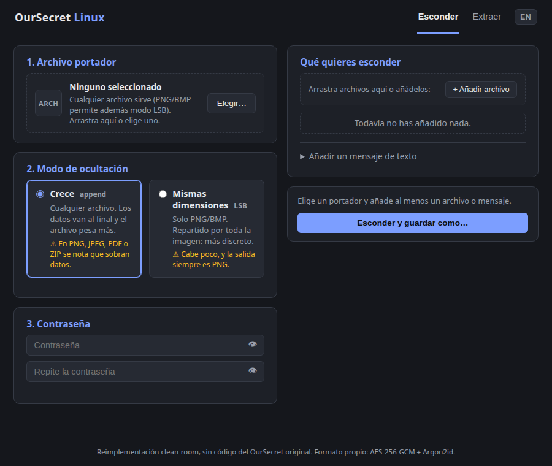

<div align="center">


# OurSecret Linux

**Esteganografía + cifrado autenticado para ocultar archivos y mensajes dentro de otros archivos.**

[](LICENSE)
[](https://www.rust-lang.org/)
[](https://v2.tauri.app/)
[](#compilar-y-empaquetar)

*Reimplementación **clean-room** de OurSecret (SecureKit.net, Windows) para Linux, Windows y macOS, con CLI y aplicación de escritorio.*

</div>

---

> ⚠️ **Estado experimental (`v0.1.0`)**: este proyecto no ha pasado una auditoría criptográfica externa y el formato del contenedor podría evolucionar sin compatibilidad hacia atrás (no incluye cabecera de versión de forma intencionada). No lo uses para proteger información crítica de la que dependa tu seguridad personal o legal.

> ℹ️ **Compatibilidad**: reproduce el *comportamiento observable* del OurSecret original a partir de análisis externo, sin copiar ni descompilar su código. **No es compatible** con los archivos generados por el OurSecret original de Windows.

---

## ¿Qué hace?

1. **Empaqueta** uno o varios archivos y/o mensajes de texto (`asunto` + `cuerpo`) en un contenedor ZIP en memoria.
2. **Deriva una clave maestra** de 256 bits a partir de tu contraseña con **Argon2id** (`m = 64 MiB`, `t = 3`, `p = 4`, sal aleatoria de 16 bytes), extrae **subclaves independientes con BLAKE2b-MAC** (separación de dominios para cifrado, máscara y permutación) y cifra con **AES-256-GCM** (nonce aleatorio de 12 bytes, tag de 16 bytes, autenticando también sal y longitud como **AAD**).
3. **Oculta** el contenedor cifrado dentro de un archivo portador (*carrier*) mediante una de dos estrategias:

| Modo | Portadores admitidos | ¿Cambia el tamaño? | Cómo oculta los datos | Nivel de discreción |
|---|---|---|---|---|
| `append` | Cualquier archivo (MP3, MP4, MKV, PDF, BIN…) | Sí, crece | Añade `[nonce \| ciphertext \| salt \| len XOR máscara]` al final del portador | En PNG, JPEG, PDF y ZIP se detectan bytes sobrantes tras el marcador de fin. En audio/vídeo pasa más desapercibido. |
| `lsb` | Imágenes **PNG** o **BMP** (salida siempre **PNG RGB**) | Mismas dimensiones | Cabecera (`160 bits`) y payload dispersos por toda la imagen (permutación por subclave) con **±1 matching** | No lo detectan los tests clásicos (chi² por prefijos, análisis RS). El estegoanálisis moderno puede notarlo con cargas altas. |

Sin la contraseña correcta, **no existe ninguna firma mágica, cabecera ni longitud en claro** que identifique el archivo como creado por este programa.

---

## Uso rápido

### Interfaz de escritorio (GUI)

Aplicación nativa construida con **Tauri 2** y detección automática de idioma (**Español / Inglés**, con conmutador `ES`/`EN` en la barra superior; arranca en inglés si el sistema no está en español):

- **Pestaña Esconder (2 columnas)**: selecciona o arrastra el archivo portador (preselecciona `LSB` automáticamente si es PNG/BMP y el contenido cabe), añade archivos (con rechazo temprano de carpetas y duplicados), o mensajes, y define la contraseña (con indicador de coincidencia y aviso si es corta). Nunca sobrescribe el portador original sin confirmación explícita mediante diálogo *Guardar como…*.
- **Pestaña Extraer**: arrastra o selecciona el archivo contenedor, introduce la contraseña y elige la carpeta de destino. Muestra los mensajes extraídos de forma segura y permite copiar texto o rutas al portapapeles.

<!-- Añade aquí una captura de la GUI tras compilarla:  -->

### Línea de comandos (`oursecret`)

```bash
# Esconder un archivo y un mensaje dentro de una imagen (modo LSB)
oursecret hide -c foto.png -o foto_secreta.png -f nota.txt -m "Aviso:leer hoy" --mode lsb

# Esconder dentro de cualquier archivo (modo append, por defecto)
oursecret hide -c cancion.mp3 -o cancion_secreta.mp3 -f documento.pdf

# Calcular cuántos bytes de usuario caben en una imagen en modo LSB
oursecret capacity -c foto.png

# Extraer contenido oculto (si no pasas -p, pide la contraseña sin eco en pantalla)
oursecret extract -i foto_secreta.png -o ./extraido
```

> 💡 **Consejo**: omite `--password` / `-p` para introducir la contraseña de forma interactiva y evitar que quede guardada en el historial de tu terminal.

---

## Seguridad: qué protege y qué no

- ✅ **Confidencialidad e integridad**: sin la contraseña no es posible leer ni alterar el contenido sin que **AES-256-GCM** lo detecte.
- ✅ **Sin huella de formato**: no hay bytes mágicos (`OSLX`, etc.), versión ni longitud en claro.
- ✅ **Defensa frente a contenedores maliciosos** (quien conoce la contraseña elige nombres y contenido):
  - **Sin sobrescritura**: `save_extracted_file` usa `create_new` atómico y renombra colisiones a `nombre (1).ext` en lugar de pisar archivos existentes.
  - **Anti zip-slip**: al extraer solo se usa el nombre base del archivo.
  - **Anti zip-bomb**: el descompresor limita el total extraído a `max(256 MiB, 20 × tamaño_blob)` leyendo por flujo (`Read::take`).
  - **Anti XSS y terminal injection**: la GUI renderiza siempre con `textContent` bajo una CSP estricta (`script-src 'self'`, verificada en CI), y la CLI neutraliza secuencias de escape ANSI y marcas bidireccionales Unicode (`U+202E`).
  - **Limpieza de claves en RAM y rollback seguro**: tanto `core` como `cli` y `gui` limpian claves/contraseñas con `zeroize`, y `append` restaura el tamaño original del portador si falla una escritura in-place.
- ⚠️ **Indetectabilidad**: en modo `append`, herramientas que inspeccionan bytes tras el EOF en PNG/JPEG/PDF/ZIP detectan datos añadidos. En modo `lsb`, el ±1 matching evita análisis clásicos como RS, pero cargas altas pueden ser detectadas por estegoanálisis estadístico moderno.
- ⚠️ **Contraseñas débiles**: Argon2id encarece los ataques por fuerza bruta, pero no sustituye a una contraseña larga y única.

Consulta [`SECURITY.md`](SECURITY.md) para el modelo de amenazas completo y cómo reportar vulnerabilidades.

---

## Compilar y empaquetar

### Requisitos

- **Rust** estable (`cargo`, `rustc`)
- **Node.js / npm** (solo para empaquetar el bundle Tauri con `npx tauri build`)
- En **Linux**, dependencias de sistema de WebKitGTK para compilar la GUI:

```bash
sudo apt-get update
sudo apt-get install -y libwebkit2gtk-4.1-dev libgtk-3-dev libayatana-appindicator3-dev librsvg2-dev
```

### Comandos de compilación y verificación

```bash
# Compilar solo la CLI en modo release → target/release/oursecret
cargo build --release -p oursecret-cli

# Ejecutar todos los tests del workspace y comprobaciones de CI
cargo fmt --all --check
cargo clippy --workspace --all-targets -- -D warnings
cargo test --workspace
node --check gui/src/main.js

# Empaquetar la GUI en Linux (.deb y .AppImage en target/release/bundle/)
cd gui && npm install && npx tauri build
```

### Releases multiplataforma (Linux, Windows y macOS)

Al publicar un tag `v*`, el workflow [`.github/workflows/release.yml`](.github/workflows/release.yml) compila y publica automáticamente junto a `SHA256SUMS.txt`:

- **Linux (`x86_64`):** `.deb`, `.rpm`, `.AppImage`, paquete portable `.tar.gz` y binario CLI (`oursecret-linux-x86_64`).
- **Windows (`x86_64`):** instalador `.msi`, instalador NSIS (`-setup.exe`), paquete portable `.zip`, GUI standalone y CLI `.exe` (MSVC, sin necesitar `WebView2Loader.dll` externa).
- **macOS (`arm64`):** imagen `.dmg`, paquete portable `.tar.gz` y binario CLI.

---

## Arquitectura del workspace

```text
OurSecret-Linux-port/
├── core/                  # oursecret-core: criptografía, ZIP en memoria, modos append y lsb
├── cli/                   # oursecret: interfaz de línea de comandos (clap + rpassword)
├── gui/
│   ├── src/               # Frontend vanilla HTML/CSS/JS con CSP estricta
│   └── src-tauri/         # Backend Tauri 2 (capa fina sobre oursecret-core)
└── .github/workflows/     # CI (Linux + Windows) y Release por tags v*
```

`oursecret-core` es la única fuente de verdad: tanto la CLI como el backend Tauri delegan en `oursecret_core::{hide, read, probe_lsb_capacity, save_extracted_file}`.

---

## Contribuir y licencia

- Lee [`CONTRIBUTING.md`](CONTRIBUTING.md) antes de abrir un *Pull Request* (incluye la **regla clean-room** obligatoria y las comprobaciones locales).
- Distribuido bajo licencia **MIT** — ver [`LICENSE`](LICENSE).
