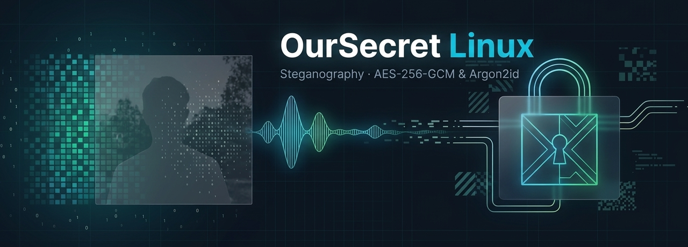

<div align="center">



# OurSecret Linux

**Steganography + authenticated encryption to hide files and messages inside any carrier file.**

🌐 **Language / Idioma:** **English** · [Español](README-ES.md)

[](LICENSE)
[](https://www.rust-lang.org/)
[](https://v2.tauri.app/)
[](#build-and-package)

*A **clean-room** reimplementation of OurSecret (SecureKit.net, Windows) for Linux, Windows, and macOS — featuring both a CLI and a native desktop GUI.*

</div>

---

> ⚠️ **Experimental status (`v0.1.0`)**: this project has not undergone an external cryptographic audit and the container format may evolve without backward compatibility (it intentionally omits magic headers and version bytes). Do not rely on it for life-critical or legal security.

> ℹ️ **Compatibility**: reproduces the *observable behavior* of the original OurSecret from external black-box observation without copying or decompiling its code. It is **not compatible** with files created by the original Windows OurSecret.

---

## How it works

1. **Packs** one or more files and/or text messages (`subject` + `body`) into an in-memory ZIP container.
2. **Derives a 256-bit master key** from your password using **Argon2id** (`m = 64 MiB`, `t = 3`, `p = 4`, random 16-byte salt), derives **domain-separated subkeys via BLAKE2b-MAC** (encryption, length mask, and permutation), and encrypts with **AES-256-GCM** (random 12-byte nonce, 16-byte authentication tag, binding salt and masked length as **AAD**).
3. **Embeds** the encrypted payload into a carrier file using one of two strategies:

| Mode | Supported carriers | Size change? | How data is hidden | Detectability |
|---|---|---|---|---|
| `append` | Any file (MP3, MP4, MKV, PDF, BIN…) | Yes, grows | Appends `[nonce \| ciphertext \| salt \| len XOR mask]` to the end of the carrier | In PNG, JPEG, PDF, and ZIP, trailing bytes after EOF can be spotted. Less noticeable in audio/video. |
| `lsb` | **PNG** or **BMP** images (output is always **RGB PNG**) | Same dimensions | Both the 160-bit header and payload are dispersed across the whole image with **±1 matching** | Defeats classical tests (prefix chi², RS analysis). Modern steganalysis can still detect high payloads. |

Without the right password, **there are no magic bytes, headers, or plaintext lengths** identifying a file as created by this tool.

---

## Quick start

### Desktop GUI

Native desktop app built with **Tauri 2** and automatic **English / Spanish** detection (starts in English by default when the OS locale is not Spanish, with an `EN`/`ES` toggle in the top bar):

- **Hide tab (2-column layout)**: pick or drag-and-drop a carrier file (automatically selects `LSB` when a PNG/BMP carrier fits your payload), add files (with early folder and duplicate-name checks) or text messages, and set a password (with live match indicator and short-password warning). Never overwrites the original carrier without an explicit *Save as…* confirmation.
- **Extract tab**: drag-and-drop or pick the stego file, enter the password, and choose an output directory. Safely renders extracted messages and lets you copy text or file paths to the clipboard.


### Command-line interface (`oursecret`)

```bash
# Hide a file and a text message inside an image (LSB mode)
oursecret hide -c photo.png -o secret_photo.png -f note.txt -m "Notice:read today" --mode lsb

# Hide inside any file (append mode, default)
oursecret hide -c song.mp3 -o secret_song.mp3 -f document.pdf

# Check how many user bytes fit in an image using LSB mode
oursecret capacity -c photo.png

# Extract hidden items (omit -p to enter password interactively without shell history leaks)
oursecret extract -i secret_photo.png -o ./extracted
```

> 💡 **Tip**: omit `--password` / `-p` to enter your password interactively so it is never stored in your shell history.

---

## Security model: what is protected and what is not

- ✅ **Confidentiality & integrity**: without the password, contents cannot be read or tampered with without **AES-256-GCM** rejecting the payload.
- ✅ **No format fingerprint**: no magic signatures (`OSLX`, etc.), version bytes, or plaintext lengths.
- ✅ **Hardening against untrusted containers** (the sender knows the password and chooses filenames/text):
  - **No overwrites**: `save_extracted_file` uses atomic `create_new` and renames collisions to `name (1).ext`.
  - **Zip-slip protection**: extraction strips directory components and keeps only the base filename.
  - **Zip-bomb protection**: streaming decompression (`Read::take`) enforces a `max(256 MiB, 20 × blob_size)` budget.
  - **XSS & terminal injection defense**: the GUI renders exclusively via `textContent` under a strict CSP (`script-src 'self'`, verified in CI), and the CLI escapes ANSI control sequences and Unicode bidirectional overrides (`U+202E`).
  - **RAM cleanup & safe rollback**: keys and passwords are zeroized on drop across `core`, `cli`, and `gui`, and in-place `append` rolls back file length (`set_len`) if a write fails mid-way.
- ⚠️ **Undetectability**: `append` leaves trailing bytes after EOF in formats like PNG/JPEG/PDF/ZIP; `lsb` ±1 matching defeats RS analysis, but high-density payloads can be flagged by modern statistical steganalysis.
- ⚠️ **Weak passwords**: Argon2id slows brute-force attacks, but does not replace a strong, unique passphrase.

See [`SECURITY.md`](SECURITY.md) for the threat model and vulnerability disclosure policy.

---

## Build and package

### Requirements

- Stable **Rust** toolchain (`cargo`, `rustc`)
- **Node.js / npm** (only needed to bundle the Tauri app with `npx tauri build`)
- On **Linux**, WebKitGTK system libraries for the GUI:

```bash
sudo apt-get update
sudo apt-get install -y libwebkit2gtk-4.1-dev libgtk-3-dev libayatana-appindicator3-dev librsvg2-dev
```

### Build & test commands

```bash
# Build only the CLI in release mode → target/release/oursecret
cargo build --release -p oursecret-cli

# Run all workspace tests and CI checks
cargo fmt --all --check
cargo clippy --workspace --all-targets -- -D warnings
cargo test --workspace
node --check gui/src/main.js
node --check gui/src/i18n.js

# Package the Linux GUI (.deb, .rpm, .AppImage in target/release/bundle/)
cd gui && npm install && npx tauri build
```

### Cross-platform Releases (Linux, Windows & macOS)

Pushing a `v*` tag triggers [`.github/workflows/release.yml`](.github/workflows/release.yml) to build and publish all binaries alongside `SHA256SUMS.txt`:

- **Linux (`x86_64`):** `.deb`, `.rpm`, `.AppImage`, portable `.tar.gz`, and CLI binary (`oursecret-linux-x86_64`).
- **Windows (`x86_64`):** `.msi` installer, NSIS installer (`-setup.exe`), portable `.zip`, standalone GUI, and CLI `.exe` (MSVC static WebView2Loader).
- **macOS (`arm64`):** `.dmg` disk image, portable `.tar.gz`, and CLI binary.

---

## Workspace architecture

```text
OurSecret-Linux-port/
├── core/                  # oursecret-core: crypto, in-memory ZIP, append & lsb modes
├── cli/                   # oursecret: command-line interface (clap + rpassword)
├── gui/
│   ├── src/               # Vanilla HTML/CSS/JS frontend with ES/EN i18n & strict CSP
│   └── src-tauri/         # Tauri 2 backend (thin layer over oursecret-core)
└── .github/workflows/     # CI (Linux + Windows) and multi-OS tag Releases
```

`oursecret-core` is the single source of truth: both the CLI and the Tauri backend delegate to `oursecret_core::{hide, read, probe_lsb_capacity, save_extracted_file}`.

---

## Contributing & license

- Read [`CONTRIBUTING.md`](CONTRIBUTING.md) before opening a Pull Request (includes the mandatory **clean-room rule** and local checks).
- Licensed under **MIT** — see [`LICENSE`](LICENSE).
